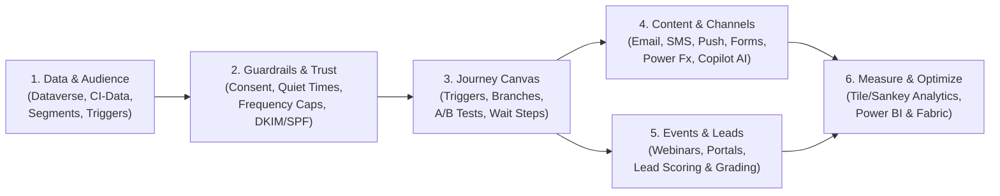

# Dynamics 365 Customer Insights – Journeys (CI-J): 10,000-Foot One-Pager

**What it is:** Microsoft's real-time, event-driven customer orchestration platform—built natively on **Dataverse**—that turns live customer signals into personalized, compliant multi-channel journeys.

---

## The Big Picture

---

## The 6 Core Pillars (Mapped to Your 8 Study Categories)

### 1. Foundation & Identity (*Architecture & Setup*)
- **Dataverse-native**: Runs directly on your CRM tables (`Contact`, `Lead`) and **Customer Insights – Data** unified profiles—no separate marketing database sync.
- **Multi-brand & multi-unit**: **Brand Profiles** keep logos/senders consistent; **Business Units** isolate data and journeys across regions or divisions.
- **Deliverability**: Custom **Domain Authentication** (DKIM, SPF, Return-Path alignment) ensures emails land in inboxes, not spam.

### 2. Trust & Guardrails (*Consent & Guardrails*)
- **Contact-Point Consent**: Consent is tracked per email address or phone number (not just per Contact record) and governed by **Compliance Profiles** and **Preference Centers**.
- **Enforcement Models**: Choose how strict consent checks are per purpose/topic (e.g., Commercial vs. Transactional vs. Tracking).
- **Fatigue Protection**: **Quiet Times** respect recipient time zones, and **Frequency Capping** limits total messages across channels over rolling windows.

### 3. Who & When (*Audience & Segments* + *Triggers & Journeys*)
- **Segments ("Who")**: Dynamic or hybrid lists built from Dataverse attributes, behavioral signals, or unified CI-Data profiles.
- **Triggers ("When")**: Instant reactions to **Dataverse record changes** (no-code) or **custom external events** (website/app actions via API).
- **Journeys**: **Segment-based** for scheduled/recurring campaigns; **Trigger-based** for real-time 1:1 moments—complete with **A/B testing** and exit criteria.

### 4. What They See (*Content, Forms & AI*)
- **Personalization**: Dynamic text, fallback values, related Dataverse tables, and **Power Fx** expressions inside emails and messages.
- **Modern Forms**: Capture leads/contacts with prefill, unmapped fields, and flexible publishing (standalone pages or embedded).
- **Copilot AI**: Assists with email copy ideas, segment/journey creation, and smart form-fill assistance.

### 5. High-Touch Engagement (*Events & Leads*)
- **Event Management**: End-to-end planning for in-person events and **Microsoft Teams webinars**, exposed via **Power Pages** or the Event API.
- **Lead Scoring & Grading**: Real-time scoring models qualify leads automatically based on engagement and profile fit before handing off to Sales.

### 6. Measure & Scale (*Analytics & Fabric* + *MVP Best Practices*)
- **Built-in Insights**: Real-time tile analytics, **Sankey drop-off views**, and channel/contact-level performance.
- **Enterprise Scale**: Direct integration with **Microsoft Fabric** and **Power BI** for cross-system reporting.
- **Production Patterns (MVP)**: ALM/solution deployment, website visitor identification mechanics, custom dashboards, and audit-ready consent architecture.

---

## One-Sentence Mental Model
> **CI-J listens to Dataverse and external triggers in real time, checks contact-point consent and fatigue guardrails, personalizes content with Copilot and Power Fx across channels, and streams every interaction to built-in analytics and Microsoft Fabric.**
